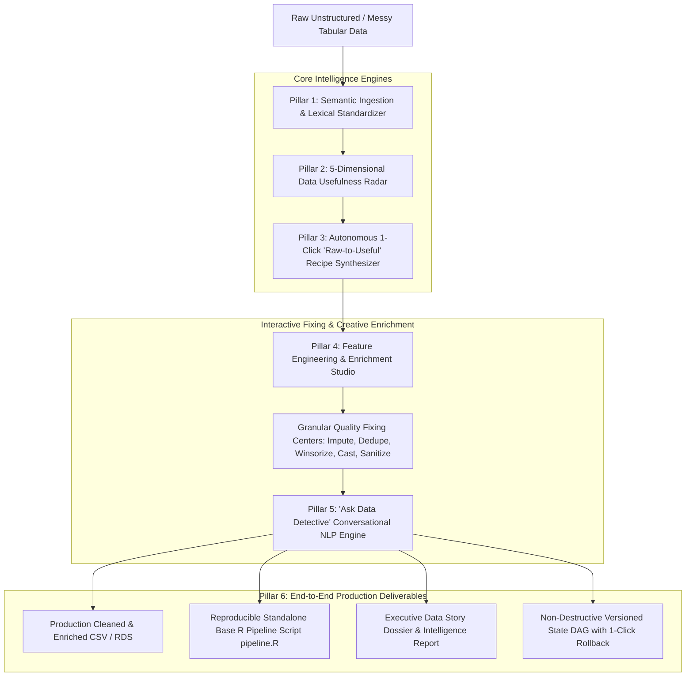

# Data Detective Pro
> **Autonomous "Raw Data to Useful Data" Intelligence & Feature Engineering Platform**  
> *"Transform Raw Data into Useful Intelligence — Deterministic, Reversible, & 100% In-Browser."*


---

## Overview

In real-world data science, **raw data is never useful data by default**. It is rife with cryptic column names, unstandardized currency strings, silent duplicate rows, missing values, extreme outlier leverage, and unextracted temporal timestamps.

**Data Detective Pro** transforms raw tabular files (CSV, TSV, TXT, or RDS) into **high-value, enriched, feature-engineered, modeling-ready data products**. Built completely with pure Base R and Shiny, fully compatible with **Shinylive** (executing locally via client-side WebAssembly with zero data egress), it delivers:

1. **Autonomous 1-Click "Raw-to-Useful" Recipe Generator**: Scans dataset defects and synthesizes an ordered, multi-step pipeline (deduplication, column name sanitization, type casting, median/mode imputation, Tukey outlier Winsorization, date extraction, and log transforms).
2. **Interactive Data Quality Fixing Workbench**: Inspect proposed changes in side-by-side cell-level diffs, apply individual or composite fixes, and rollback anytime with an audit timeline.
3. **Feature Engineering & Enrichment Studio**: Derive temporal dates, cyclical sine/cosine seasonality coordinates, log1p variance stabilizers, Z-score/Min-Max scaling, business ratios ($A/B$), quantile tier binning, text metadata, and one-hot binary indicator dummies.
4. **Column Studio**: Univariate statistical deep dive featuring histograms, boxplots, violin plots, empirical cumulative distributions (ECDF), QQ-plots, quantile tables, and plain-language statistical interpretations.
5. **"Ask Data Detective" Conversational Intelligence Engine**: Deterministic in-browser question answering for key drivers, anomaly hunting, missingness hotspots, and executive dataset summaries.
6. **5-Dimensional Data Usefulness Radar**: Tracks Completeness, Uniqueness, Validity, Distributional Stability, and Modeling Readiness ($0-100$).
7. **Production Deliverables Ecosystem**: Export cleaned & enriched CSV/RDS datasets, plus a **standalone reproducible Base R script (`pipeline.R`)** to rerun the entire pipeline in any headless environment or CI/CD workflow.

---

## The 6 Architectural Pillars



---

## Core Capabilities

### 1. Autonomous One-Click Smart Recipe
Data Detective Pro inspects your dataset and synthesizes an ordered recipe tailored to your exact data profile:
- **Header Normalization**: Sanitizes messy headers (`" Annual Income ($)"` $\to$ `annual_income_usd`).
- **Exact Deduplication**: Drops redundant copies, preserving authentic sample weights.
- **Currency & Percentage Parsing**: Strips `$`, `€`, `£`, `%` and commas, converting text to continuous floats.
- **Statistical Imputation**: Fills missing numbers with medians and categories with modes.
- **Tukey Outlier Winsorization**: Clamps extreme outliers to $[Q_1 - 1.5\text{IQR}, Q_3 + 1.5\text{IQR}]$ bounds to preserve rows without distorting variance.
- **Feature Enrichment**: Automatically extracts temporal calendar features and applies $\log(1+x)$ transforms to heavily skewed columns ($skew > 1.5$).

### 2. Feature Engineering & Enrichment Studio
- **Temporal Features**: `_year`, `_month`, `_quarter`, `_day`, `_day_of_week`, `_is_weekend`.
- **Cyclical Trigonometric Encodings**: $\sin(2\pi m / 12)$ and $\cos(2\pi m / 12)$ for periodic seasonality.
- **Variance-Stabilizing Transforms**: $\log(1+x)$ with negative-offset handling.
- **Standardization & Scaling**: Z-score ($z = \frac{x-\mu}{\sigma}$), Min-Max $[0, 1]$, and Robust Median/IQR.
- **Business Ratios**: Custom ratios ($Col_A / Col_B$) with division-by-zero safeguards.
- **Quantile Binning**: Balanced quartiles/quintiles with business labels (`Low (Q1)`, `Moderate (Q2)`, `High (Q3)`, `Top Tier (Q4)`).
- **One-Hot Dummy Indicators**: Binary $0/1$ flags for dominant category classes.
- **Text Metadata**: Character length and word count feature extraction.

### 3. Column Studio (Univariate Drilldown)
- Dynamic plot selection: Histogram, Boxplot, Violin, ECDF, QQ-Plot.
- Complete 5-number summary: Min, $Q_1$, Median, Mean, $Q_3$, Max, IQR, Skewness, Kurtosis.
- Plain-English distribution interpretation: Explains skewness direction, modality, and spread facts.

### 4. "Ask Data Detective" Conversational Intelligence
- Plain-language deterministic inquiry:
  - *"What are the key drivers?"* $\to$ Top correlated pairs, multicollinear predictors ($|r| \ge 0.70$).
  - *"Identify extreme outliers"* $\to$ Tukey boundary violations and leverage points.
  - *"Executive summary"* $\to$ Complete narrative dataset dossier with volume, health score, and readiness.
- Instant clickable prompt chips for rapid discovery.

### 5. Reproducible Base R Pipeline Script
- Download a standalone `.R` script that replicates every cleaning and feature engineering step performed in the UI using pure Base R.
- Zero dependencies on Shiny for execution — run it headlessly in terminal, Docker, Airflow, or GitHub Actions!

---

## Technology Stack

- **Primary Language:** R ($\ge 4.0.0$)
- **Framework:** Shiny
- **UI Architecture:** `bslib` (Bootstrap 5 theme with responsive sidebar and Data-Dense CSS tokens)
- **Data Wrangling:** Pure Base R (`utils`, `stats`, `tools`) for bulletproof WebAssembly/Shinylive compatibility
- **Data Visualization:** `ggplot2`
- **Interactive Tables:** `DT` (DataTables)
- **Deployment:** Static WebAssembly via **Shinylive** on GitHub Pages

---

## Project Structure

```
data-detective/
├── app.R                          # Main Shiny Application Shell & Reactive Orchestrator
├── DESCRIPTION                    # R Package & Dependency metadata
├── LICENSE                        # MIT License
├── README.md                      # Comprehensive project documentation
│
├── R/                             # Modular Analytical Engines & UI Modules
│   ├── transformation_engine.R    # Deterministic cleaning, diff engine, clean_names, currency
│   ├── feature_engine.R           # Temporal, cyclical, log1p, scaling, ratio, binning, text
│   ├── recipe_engine.R            # Autonomous recipe synthesizer, executor & R script generator
│   ├── query_engine.R             # Deterministic natural language query parser
│   ├── mod_workbench.R            # Interactive Quality Fixing & Feature Studio Workbench
│   ├── mod_column_studio.R        # Univariate deep drilldown studio
│   ├── analysis_functions.R       # Centralized statistical and health radar engines
│   ├── validation_functions.R     # Ingestion validation and delimiter detection
│   ├── utility_functions.R        # Safe moments, type detection & formatting
│   ├── mod_overview.R             # Overview KPI cards & preview
│   ├── mod_quality.R              # Quality score indicator & deductions
│   ├── mod_missing.R              # Missing value diagnostics
│   ├── mod_duplicates.R           # Duplicate row diagnostics
│   ├── mod_outliers.R             # Outlier diagnostics & plots
│   ├── mod_distributions.R        # Distribution diagnostics
│   ├── mod_correlation.R          # Correlation heatmaps & alerts
│   ├── mod_relationships.R        # Bivariate relationship explorer
│   ├── mod_leakage.R              # Target leakage indicators
│   ├── mod_bias.R                 # Representation disparity screening
│   └── mod_report.R               # HTML report export
│
├── www/                           # Frontend Assets & CSS Tokens
│   ├── styles.css                 # Data-Dense styling, diff badges & tabular typography
│   └── app.js                     # Client-side UI enhancements
│
├── sample_data/                   # Benchmark Synthetic Datasets
│   ├── sample_clean.csv           # Baseline clean HR dataset
│   ├── sample_messy.csv           # Anomaly dataset (missingness, duplicates, outliers)
│   └── sample_sales.csv           # Business sales dataset
│
└── tests/                         # Automated Unit Tests
    ├── test_transformations.R     # Unit tests for transformations, features, recipes, queries
    ├── test_analysis.R            # Core statistical engine tests
    ├── test_validation.R          # Input validation tests
    └── test_modules.R             # Module tests
```

---

## Running Locally

### Prerequisites

Install R ($\ge 4.0.0$) and required packages:

```r
install.packages(c(
  "shiny",
  "bslib",
  "DT",
  "ggplot2",
  "testthat"
))
```

### Launching the Application

```r
# In R or RStudio console:
shiny::runApp(".")
```

---

## GitHub Pages Deployment

Data Detective Pro is architected for zero-server **Shinylive** deployment via GitHub Pages.

An automated GitHub Actions workflow is pre-configured in [`.github/workflows/deploy-shinylive.yaml`](.github/workflows/deploy-shinylive.yaml):
1. Checks out the repository.
2. Installs R and Shinylive dependencies.
3. Exports the R/Shiny application to static WebAssembly files (`shinylive::export(".", "site")`).
4. Deploys the static site directly to **GitHub Pages**.

---

## Privacy & Security

- **100% Client/Local Processing**: Your dataset is processed entirely in the local R runtime or locally within your browser's WebAssembly sandbox.
- **Zero Cloud Egress**: No data ever leaves your computer.
- **No External AI APIs**: Fully deterministic rule-based algorithms with zero dependency on third-party cloud LLMs.

---

## License & Author

- **Author:** Vijay Mahes
- **Email:** [Vijaypradhap2004@gmail.com](mailto:Vijaypradhap2004@gmail.com)
- **License:** [MIT License](LICENSE)
